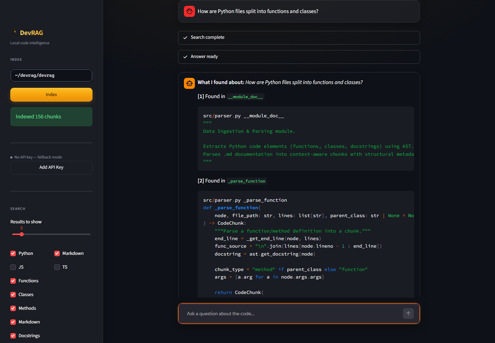

# DevRAG

[](LICENSE)
[](https://python.org)
[](https://streamlit.io)
[](https://github.com/ahmedbasolan/devrag)
[](https://github.com/ahmedbasolan/devrag/actions/workflows/ci.yml)

⚡ Ask questions about any codebase. Get answers with source citations. Zero-cost, privacy-first, runs entirely on your machine.



## Quickstart

```bash
git clone https://github.com/ahmedbasolan/devrag.git
cd devrag/devrag
pip install -r requirements.txt
streamlit run src/app.py
```

Open [http://localhost:8501](http://localhost:8501). On first run the app downloads a small embedding model and indexes its own source, so you can start asking questions immediately. No API key needed: choose **Continue without AI** for search with cited code snippets, or add a Gemini, Groq or OpenAI key for written answers.

## Features

- **AST-based Python parsing** — Exact function/class boundaries, not regex
- **Hybrid RAG** — BM25 sparse + ChromaDB dense embeddings + Reciprocal Rank Fusion
- **Code-aware tokenizer** — Handles snake_case, camelCase, dotted names, string literals
- **Multi-provider** — Gemini, Groq, OpenAI with graceful fallback
- **Code-first ranking** — docs weigh half in the merge (except "why" questions, where ADRs win), at most 2 leading results per file, tests left out of the index by default
- **Streamlit UI** — Dark theme, expandable result cards with file, line range and chunk type
- **Measured on code it wasn't built against** — Hit@5 0.93 and MRR 0.61–0.65 on two held-out repos, scored before and after each change, plus a 21-query regression suite on its own source; see [devrag/README.md](devrag/README.md#evaluation)
- **Stress tested** — Edge cases, adversarial inputs, repeated queries

## License

MIT — See LICENSE file for details.
